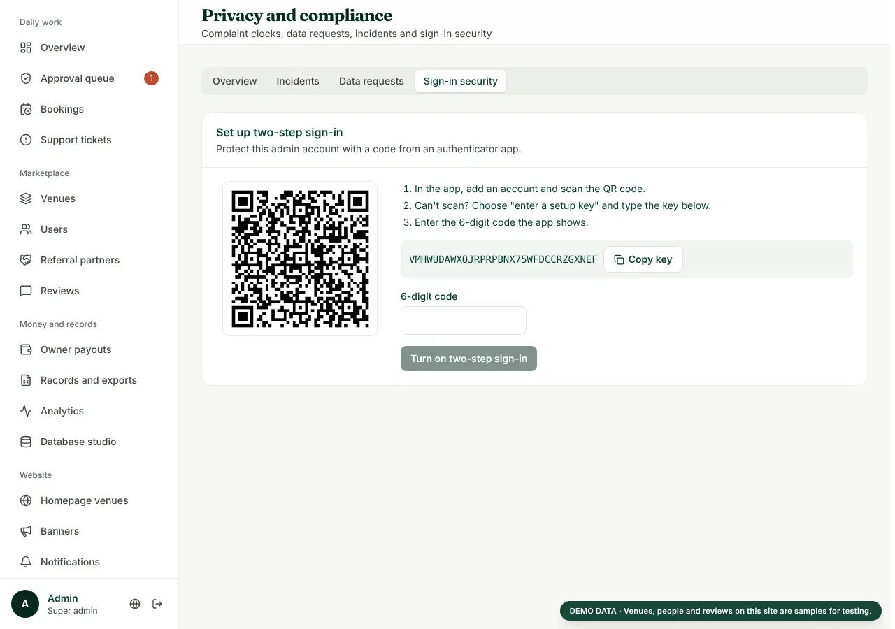
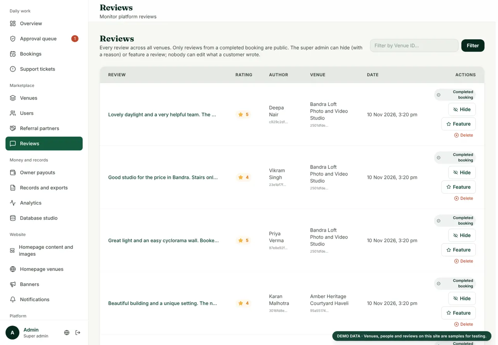
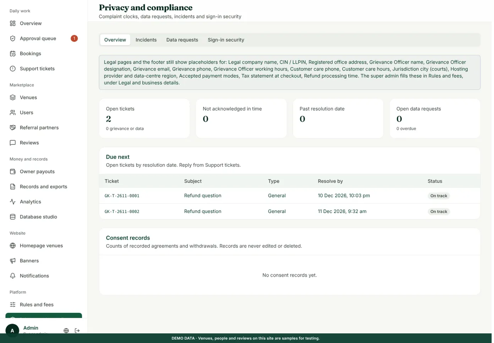
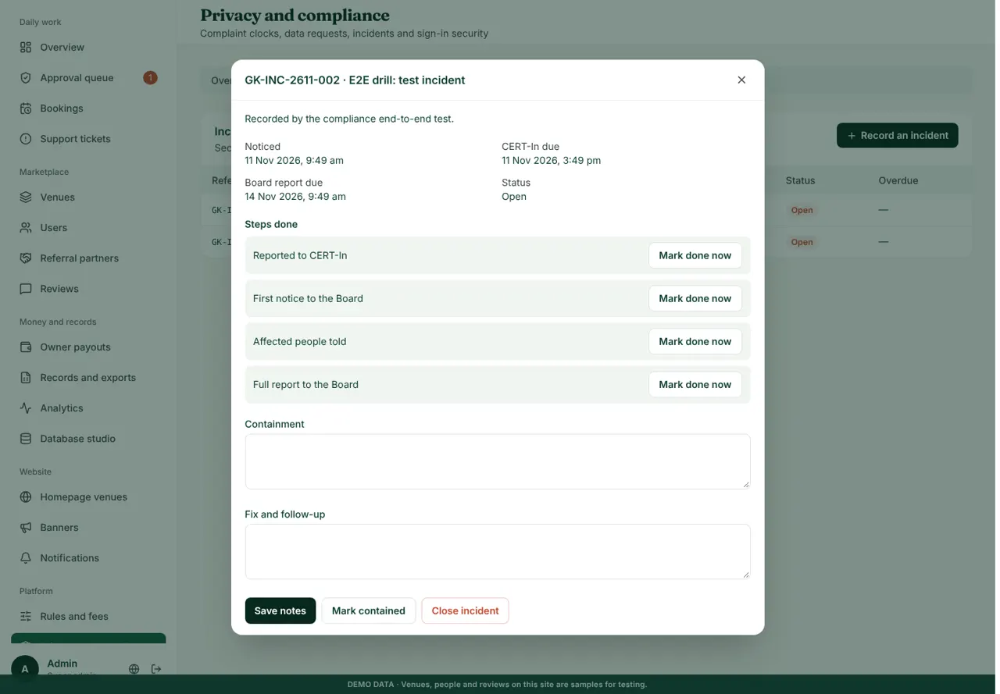

# GroundKart Admin Guide

For everyone who runs the GroundKart admin console day to day. The super admin has extra powers, described in the [Super Admin Guide](SUPER_ADMIN_GUIDE.md); everything here applies to the super admin too.

Version 1.0 · 11 November 2026

---

## 1. Signing in

1. Go to `https://groundkart.com/admin` (or your domain) and sign in with your email or phone and password.
2. **Two-step sign-in.** On the live site every admin must use an authenticator app (Google Authenticator, Microsoft Authenticator, 2FAS or similar). The first time, the console shows **Set up two-step sign-in**:
   - Press **Start set-up**, scan the QR code with the app (or type the setup key), enter the 6-digit code and press **Turn on two-step sign-in**.
   - **Save the recovery codes** shown next. Each one works once if you lose your phone. They are not shown again.
   - Press **I saved them. Sign in again**, then sign in with your password and a code from the app.
   
3. From then on every sign-in asks for the 6-digit code. If you lose your phone, use a recovery code, or ask the super admin.

New admins receive a one-time set-password link (valid 24 hours) from the super admin. Nobody else ever sees your password.

**Keep the console safe:** never share your account, sign out on shared computers, and never paste customer data into chat apps or email unless the customer asked you to.

---

## 2. Finding your way

The left menu is grouped by what you do:

| Group | Pages |
| --- | --- |
| Daily work | Overview, Approval queue, Bookings, Support tickets |
| Marketplace | Venues, Users, Referral partners, Reviews |
| Money and records | Owner payouts, Records and exports, Analytics, Database studio |
| Website | Homepage content and images, Homepage venues, Banners, Notifications |
| Platform | Rules and fees, Privacy and compliance, Passwords, Admin team (super admin only) |

Your name and role (Admin or Super admin) are at the bottom left, with sign out.

---

## 3. Daily work

### 3.1 Overview

Today's numbers (bookings, payments waiting, approvals waiting, tickets) and the latest audit log entries. Click a card to jump to the matching page.

### 3.2 Approval queue

Two lists:

- **Venues waiting for review.** Open a listing, check photos, address, prices, capacity and house rules against what the owner sent. **Approve** publishes it. **Reject** asks for a reason, which the owner sees; be specific ("the photos show a different hall").
- **Owner verifications.** Owners prove who they are before they can list. **View document** opens the uploaded ID (each opening is logged). ID numbers are masked; **Show full numbers (logged)** reveals them only when you need to match them against the document. **Approve** or **Reject** with a reason.

Rules: approve only what you have checked; never approve on the owner's word alone; never download ID documents to your own computer.

### 3.3 Bookings

A booking is a **request** until payment is recorded, then **confirmed**.

- **Find a booking** by its reference number with the lookup box.
- **Confirm payment** when money has actually reached GroundKart: enter the **amount received** and the **method** (cash, UPI, bank transfer). The amount must match what is due; a mismatch is refused, so check with the customer before trying again. Confirmation records the payment, the platform commission and any partner commission in one step.
- **Cancel** a pending request when the customer asks or the hold should end. Refunds follow the rules in Rules and fees and are shown to the customer.
- **Sweep expired holds now** frees slots whose hold time ran out without payment. The system also does this on its own every few minutes.

Never confirm a payment you have not seen in the bank, UPI app or cash book.

### 3.4 Support tickets

Every message from the Contact page, the help centre and signed-in users becomes a ticket with a number like `GK-T-2611-0042`.

- Each ticket shows when it must be **acknowledged** (48 hours) and **resolved** (one month; 15 days for complaints about content; data requests 30 days). Red badges mean late.
- Reply in the ticket. Your first reply or a status change counts as the acknowledgement.
- Tick **internal** on a comment for notes the customer must not see (shown highlighted).
- Guest tickets (no account) show "Guest"; reply by the email or phone they gave.

Complaints about personal data, privacy or a review also appear in **Privacy and compliance**.

---

## 4. Marketplace

### 4.1 Venues

All listings with status. **Suspend** (with a reason) takes a live venue off the site at once, for example after a serious complaint; **Reactivate** brings it back. Changes owners make to key details go back to the Approval queue.

### 4.2 Users

Customers, owners and partners.

- **Suspend** with a reason blocks sign-in and ends their sessions; **Reactivate** reverses it.
- **Under 18** is for an account that turns out to belong to a minor. GroundKart is for adults only. Type `ERASE` to confirm: the account is closed and its personal data erased, keeping only records the law requires (such as payment entries). It cannot be undone, so be sure first.

### 4.3 Referral partners

Partners bring venue owners and earn a share of paid bookings at those venues. Admins add partners, keep contact and payout details current, see their venues, bookings and commission, and record partner payouts. Commission rate, status (active or paused) and code regeneration are for the super admin.

### 4.4 Reviews

Every review on the site, with the venue and author.

- **Completed booking** means the review comes from someone whose booking at that venue was completed. Only these are ever public, and only they count towards the star rating.
- **Hidden** and **Featured** show the super admin's moderation (the reason appears under the badge).
- Admins can read everything. Hiding and featuring are for the super admin. **Delete** removes a review permanently: use it only for clear abuse or illegal content, and tell the super admin.

Nobody can edit what a customer wrote or the stars they gave. Never ask a customer to change a review in exchange for anything.

---

## 5. Money and records

### 5.1 Owner payouts

**Run payouts** for an owner and a date range creates a payout of the money due after commission and the hold-back period. When you have actually sent the money, press **Mark Paid**. Keep the bank or UPI reference in your payment records (the payout row shows the bookings and amount it covers). Every payout lists the bookings it covers.

### 5.2 Records and exports

The full register: one row per listing and one row per booking, with owner, partner, payment, commission and payout already joined. Filters match the CSV downloads, so a download is always what you see on screen. Every download is written to the audit log. Spreadsheet formula characters are neutralised, so files are safe to open in Excel.

Downloads contain personal data. Keep them on company devices, do not email them around, and delete them when you are done.

### 5.3 Analytics

Trends for bookings, revenue, venues and users. No personal data.

### 5.4 Database studio

For troubleshooting only. Lists tables and rows. Passwords, login tokens, two-step secrets, ID and bank numbers and IP data always show as `[hidden]`. Every table you open, every export and every query is logged with your name. The free-form SQL box is switched off on the live site.

---

## 6. Website

- **Homepage content and images:** you can see the published homepage text, sections and images. Only the super admin can change them.
- **Homepage venues:** choose which venues appear in the featured, trending and other homepage rows.
- **Banners:** promotional banners in three places: homepage feature card, the thin announcement strip at the top, and the line above search results. Each can be scheduled and ordered. Links must be a page on this site (`/search?...`) or a full `https://` address. Visitors can close the announcement strip, and it stays closed for them until you publish a different one.
- **Notifications:** send an in-app notice to users and see what was sent.

Everything published must be true. No fake countdowns, "only 2 left", invented discounts or reviews (Consumer Protection dark-pattern rules).

---

## 7. Platform

### 7.1 Rules and fees

Booking hold time, the owner review window, refund tiers, platform commission and payout hold-back. The homepage, checkout and the refund policy all read these numbers, so they always agree. Every change is logged with before and after values.

Below the rules, **Legal and business details** (company name, CIN, registered office, Grievance Officer, jurisdiction, customer care) fill the legal pages and footer. Only the super admin edits them.

### 7.2 Privacy and compliance

- **Overview:** open tickets, late acknowledgements and resolutions, open data requests, consent counts, and any legal detail still showing a placeholder.
- **Incidents:** if you notice a possible security problem or personal data leak, **record it immediately** with **Record an incident**. The page shows the deadlines: CERT-In within **6 hours** of noticing a cyber incident, the Data Protection Board within **72 hours**, and affected people without delay. Mark each step done as it happens, and add containment and fix notes. Follow `docs/compliance/drafts/breach-response-plan.md` and tell the super admin at once.
  
- **Data requests:** people asking to see, correct or erase their data, or to name a nominee. Downloads and self-service deletions complete automatically; the rest you handle and then mark **Done** or **Decline** (a reason is required and shown to the person). Due dates are shown; do not let them go red.
- **Sign-in security:** your two-step sign-in set-up.

### 7.3 Passwords

People who forgot their password ask for a reset from the sign-in page; the request appears here. Check it is really them (call the number on the account), then create a one-time reset link and send it to them. You must give a reason, which is logged. Admins cannot reset another admin's or the super admin's password.

---

## 8. Good habits

1. Check before you approve, confirm or pay. Every action is logged with your name.
2. Answer tickets within 48 hours, even if only to say you are looking into it.
3. Personal data stays in the console: no screenshots of ID documents, no customer lists in WhatsApp.
4. Report anything odd as an incident straight away. A false alarm costs nothing; a late report can cost a lot.
5. If a customer says they are under 18, use **Under 18** in Users and do not take their booking.

## 9. Who to ask

- Product or access problems: the super admin.
- Anything legal (complaints threatening action, police or court requests, data breach questions): the Grievance Officer named in the footer, and the company's lawyer.
