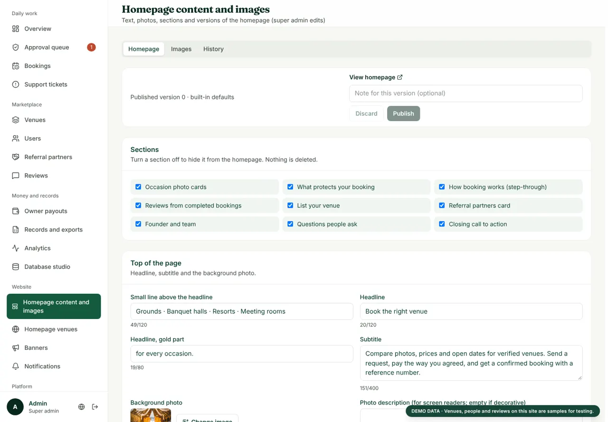
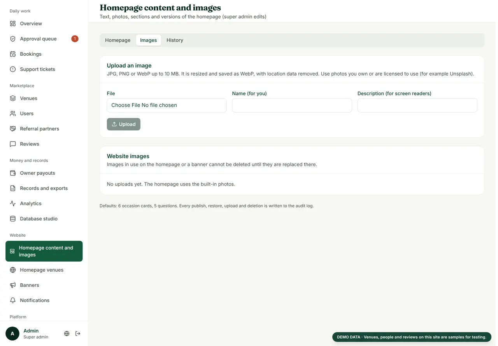

# GroundKart Super Admin Guide

For the platform owner. There is exactly **one** super admin. You can do everything in the [Admin Guide](ADMIN_GUIDE.md), plus the controls below. Read the Admin Guide first.

Version 1.0 · 11 November 2026

---

## 1. Your first day on the live site

Do these once, in this order. Each takes a few minutes.

1. **Create your account** on the server (the developer or you, following `docs/09-operations-and-deployment/DEPLOYMENT.md` §6):
   `docker compose exec -e ADMIN_EMAIL=you@example.com -e ADMIN_PHONE=98XXXXXXXX -e ADMIN_NAME="Your Name" api python -m scripts.admin_setup`
   It prints a one-time password; sign in at `/admin` and change it.
2. **Turn on two-step sign-in** (the console asks for it). Store the recovery codes in your password manager, not on your phone.
3. **Rules and fees → Booking, refund and payout rules:** confirm hold time, refund tiers, commission and payout hold-back.
4. **Rules and fees → Legal and business details:** enter the legal company name, CIN, registered office, Grievance Officer (name, designation, email, phone, hours), customer care, jurisdiction city, hosting provider, payment modes, tax statement and refund processing time. Until you do, the legal pages and footer show `[[OWNER TO FILL: …]]`. Have your lawyer check these, and the policy drafts, before launch.
5. **Admin team:** add the people who will run the console (section 5).
6. **Homepage content and images:** check the homepage text, especially the founder section, and publish any changes (section 2).
7. Run `sh deploy/hostinger/check_exposure.sh https://your-domain` once the site is live; it must end with "All exposure checks passed."

---

## 2. Homepage content

**Admin → Website → Homepage content and images → Homepage.**

Everything visitors read on the homepage can be changed here without a developer:

| Part | What you can change |
| --- | --- |
| Sections | Turn any section on or off: occasion cards, booking protections, how booking works, reviews, list your venue, referral partners card, founder and team, questions, closing call to action |
| Top of the page | Small line above the headline, headline, gold part of the headline, subtitle, background photo and its description, the occasion shortcuts under the search bar |
| Occasion cards | 3 to 8 cards: label, which search it opens, photo, photo description; add, remove, reorder |
| Section headings | Title and intro of "What protects your booking", "How booking works" and the reviews section |
| List your venue | Title, three points, button text, photo |
| Founder and team | Small line, title, story, name, role, link, and up to six background lines |
| Questions people ask | Up to 12 questions and answers; reorder |
| Closing | Text and button |

How it works:

- Make your changes, add a short **note** (for example "Diwali headline"), then press **Publish**. Visitors see it within a minute. **Discard** throws away unpublished edits. Use **View homepage** to check, in a private window if you are signed in.
- Leaving a text box **empty** uses the built-in text for that box.
- If someone else published while you were editing, Publish stops and asks you to reload, so nobody overwrites another person's work.
- **History** lists the last 30 published versions with who published them and the note. **Restore** publishes an old version again (as a new version, so nothing is lost).
- **Reset everything to built-in defaults** goes back to the original text and photos; the current version stays in History.

What you cannot change here, on purpose:

- **Numbers that are promises**: the hold time, refund percentages and hours, and the ₹0 platform fee inside "What protects your booking" always come from **Rules and fees**. Change them there, and the homepage, checkout and refund policy change together.
- **Reviews**: the reviews section only shows real reviews from completed bookings (see section 4).
- **HTML or scripts**: all text is shown exactly as typed.

Write only what is true and current. Do not add countdowns, "only N left", or claims you cannot prove. These are banned as dark patterns under the Consumer Protection rules. The founder story should contain only facts you are happy to stand behind publicly.

---

## 3. Images

**Website → Homepage content and images → Images.**

- **Upload** a JPG, PNG or WebP up to 10 MB with a name (for you) and a description (read aloud by screen readers; describe what is in the photo). The server resizes it, converts it to WebP and removes location data.
- Use only photos you own or are licensed to use. Unsplash photos are fine; photos copied from other websites are not.
- Pick images for the homepage with **Change image** in the editor. It shows your uploads and the built-in photos.
- You can rename an image or change its description at any time.
- **Delete** is refused while an image is used on the homepage or in a banner; the message says where. Replace it there first.
- Photo tips: landscape for the background (at least 1600 px wide), portrait (4:5) for occasion cards, real venues in daylight, no text baked into the image.

Banner images are uploaded on the banner itself (Website → Banners).

---

## 4. Reviews

**Marketplace → Reviews.** Only reviews from a customer's **completed booking** are ever public and counted in ratings. You have two controls. Nobody can edit a customer's words or stars.

- **Hide** (a reason is required, for example "contains a staff member's phone number", "abusive language", "spam", "about a different venue"). The review leaves the venue page, the homepage and the rating straight away. **Show again** reverses it. The reason and your name are kept in the audit log.
- **Feature** puts a completed-booking review first in the homepage reviews section. Hidden reviews and reviews without a completed booking cannot be featured.

Never hide a review just because it is negative, and never feature only praise while hiding criticism. Selective moderation is a dark pattern and misleads customers. If a negative review is unfair, reply through support and fix the problem.

**Delete** is permanent and is only for clearly illegal content; prefer Hide.

---

## 5. Admin team

**Platform → Admin team** (only you see this).

- **Add admin:** name, email and phone. They get a one-time set-password link valid for 24 hours; send it to them yourself. They must turn on two-step sign-in at first sign-in.
- **Suspend** an admin who leaves or should no longer have access. Do it on their last day. Their past actions stay in the audit log.
- Only you can add or suspend admins, set referral partner rates and status, regenerate partner codes, set the default partner rate, edit the website and legal details, and moderate reviews.
- Give the console only to people who need it. Every admin can see customer bookings and contact details.

**Moving the super admin role** to someone else (for example when selling the business) is done on the server, not in the console:
`docker compose exec -e ADMIN_EMAIL=new@example.com -e ADMIN_PHONE=... -e ADMIN_SUPER=transfer api python -m scripts.admin_setup`
The old account stays as a normal admin; suspend it if needed.

---

## 6. Referral partners

**Marketplace → Referral partners.** In addition to what admins can do, you:

- set each partner's **commission rate** and what it is calculated on, and **pause** or reactivate a partner;
- **regenerate** a partner's code if it leaked (the old code stops working; venues already linked keep their link);
- set the **default partner rate** for new partners in **Rules and fees**.

Commission is fixed at the moment a payment is confirmed, so changing a rate affects only future payments.

---

## 7. Money settings

**Rules and fees.** Changes apply to new bookings from the moment you save. Every change is logged with before and after values.

- **Hold an unpaid request for**: how long a slot is held while the customer pays.
- **Refund tiers**: full refund if cancelled at least N hours before, partial refund percentage if cancelled at least M hours before, nothing later. If the venue or GroundKart cancels, the customer always gets 100%.
- **Commission** and **payout hold-back days**.

Have a lawyer confirm your cancellation charges (E-Commerce Rules r.4(10); question Q-22 in `docs/compliance/RESEARCH.md`).

---

## 8. Privacy, security and compliance

You are accountable for these. The console does most of the work; your job is to keep the inputs current and react to alerts.

- **Grievance Officer:** make sure a real, India-based person is named in Legal and business details and answers within the deadlines shown in Privacy and compliance.
- **Incidents:** if a breach is suspected, it is recorded in Privacy and compliance → Incidents. You decide on and sign the reports: CERT-In within 6 hours of noticing, Data Protection Board within 72 hours, affected people without delay. Use the plan in `docs/compliance/drafts/breach-response-plan.md`.
- **Vendor contracts:** sign data-processing terms with Hostinger and any other provider that holds customer data, and record them in `docs/compliance/drafts/vendor-register.md`.
- **Database studio:** sensitive columns are always hidden and every look is logged. The SQL box is off on the live site. If a developer needs it for an investigation, they switch it on in the server settings (`ADMIN_SQL_CONSOLE=true`) for that session only and switch it off afterwards.
- **Audit log:** Overview and Analytics show recent actions. Review it monthly for anything unexpected (late-night exports, many ID reveals).
- **Backups:** the server takes a database backup before every deploy and every night. Make sure copies are also kept off the server (decision D-25).
- **Open decisions:** `DECISIONS_NEEDED.md` lists the business facts and choices only you can make. The compliance score reaches 36/36 once D-01 to D-04 and D-09 are done.

---

## 9. Monthly checklist

1. Privacy and compliance: no red items; data requests and tickets closed on time.
2. Admin team: remove anyone who no longer needs access.
3. Reviews: look at hidden reviews and confirm each reason still holds.
4. Homepage: text and photos still true (offers ended, team changes).
5. Rules and fees and Legal and business details still correct.
6. Run `check_exposure.sh` against the live site.
7. Read the audit log for the month.
8. Check that the latest off-server backup exists and can be opened.

## 10. Key dates

| Date | What |
| --- | --- |
| Now | SPDI Rules 2011, E-Commerce Rules 2020, dark-pattern guidelines and CERT-In directions apply |
| 1 January 2027 | E-Commerce (Amendment) Rules 2026: keep an annual dark-pattern self-audit record (run `docs/compliance/score.py` and file the output) |
| 13 May 2027 | DPDP Act core duties and penalties apply (possibly 14 May; lawyer question Q-1) |

This guide is operational guidance, not legal advice. Policy texts on the site are drafts for your lawyer to review.
